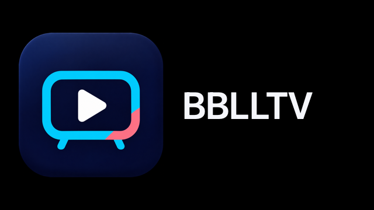
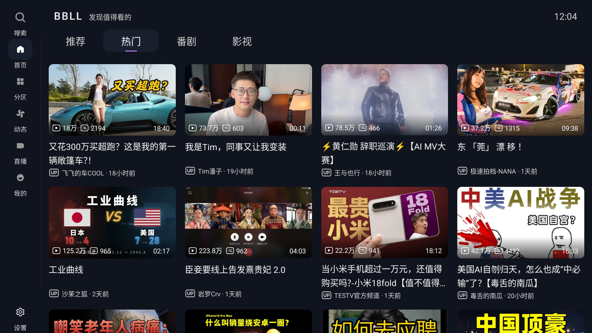
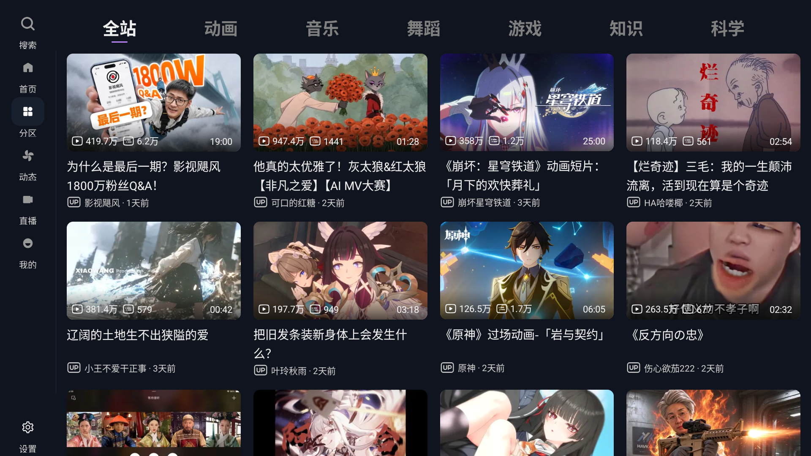
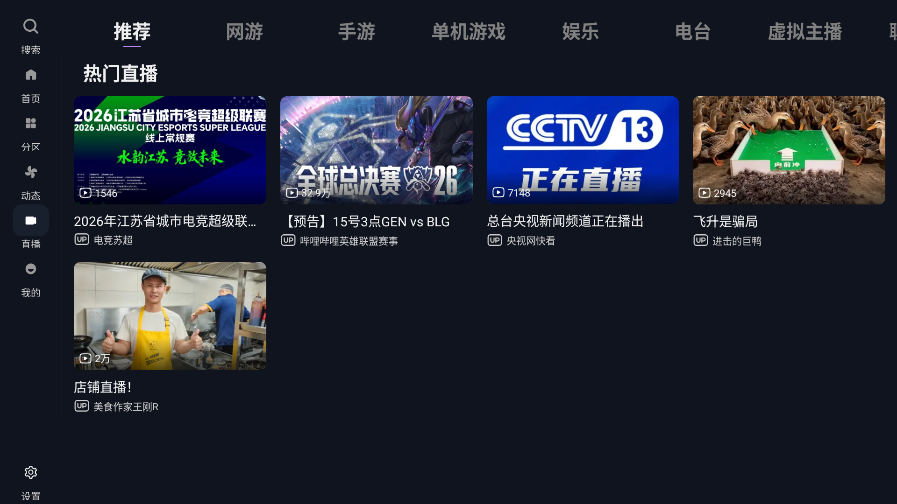
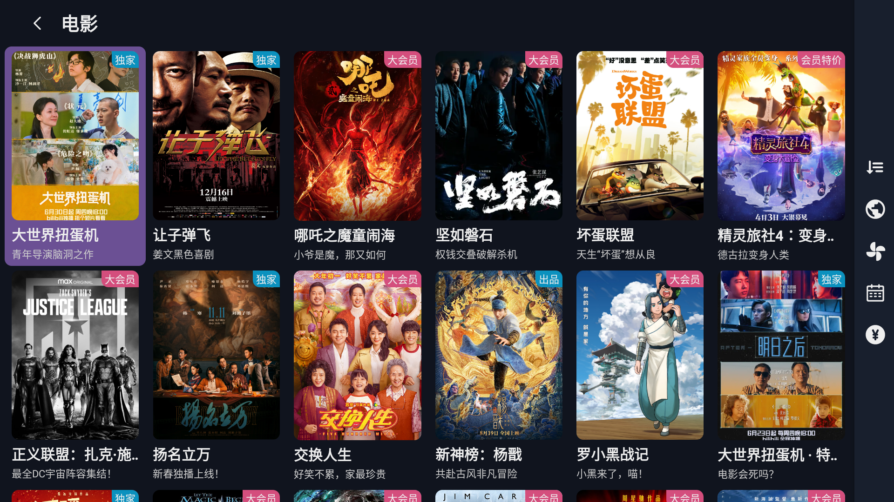
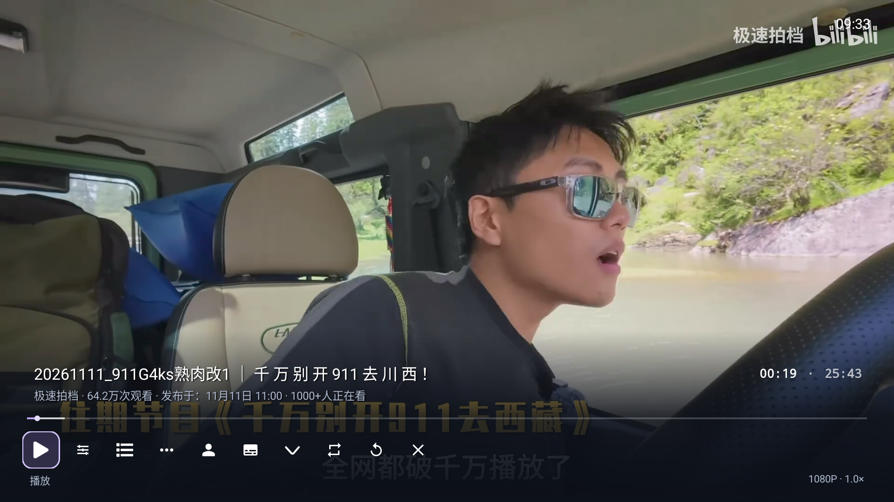
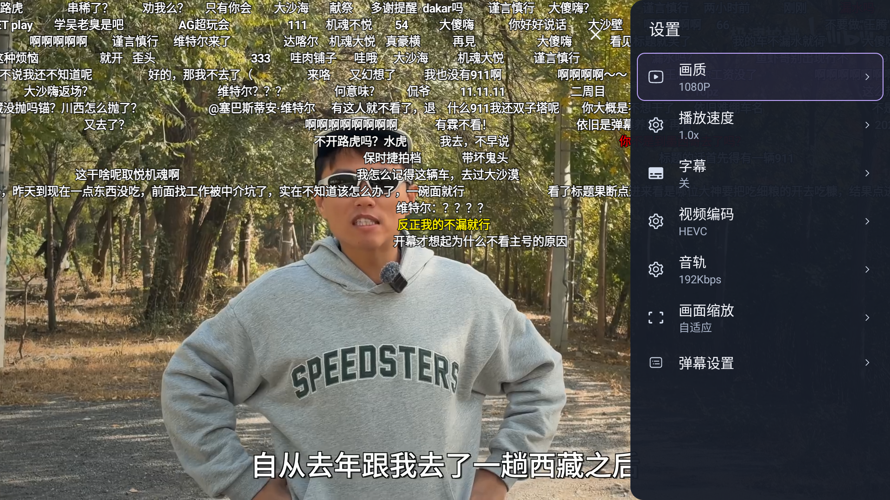
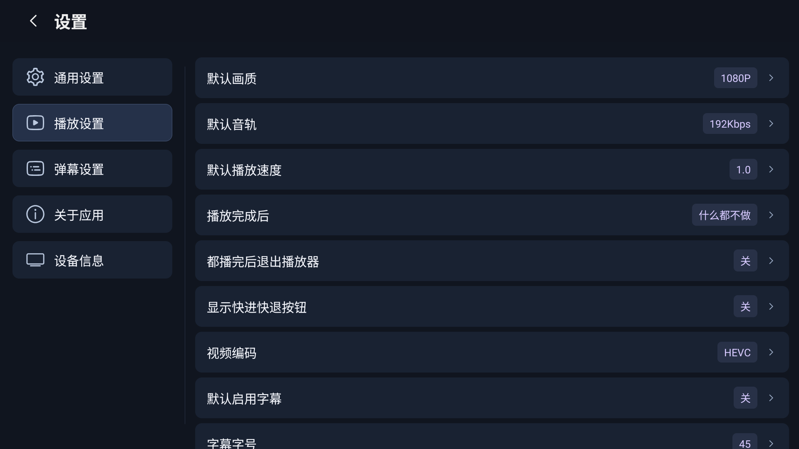
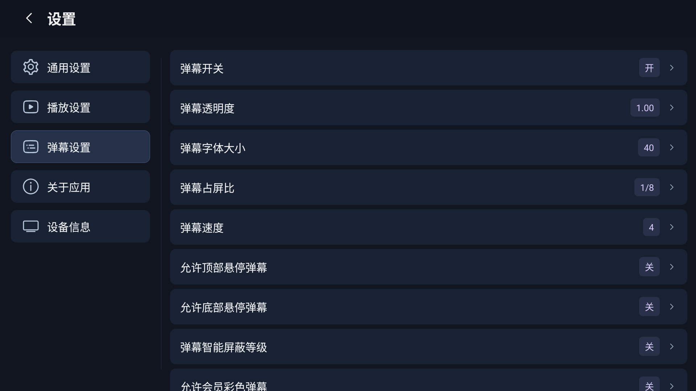
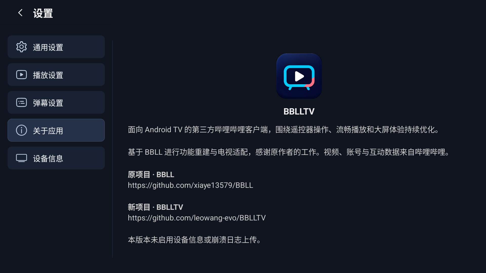

<div align="center">



# BBLLTV

面向 Android TV 的第三方哔哩哔哩客户端

为遥控器操作、流畅播放和大屏浏览持续优化。


[下载安装](#下载安装) · [功能特色](#功能特色) · [界面预览](#界面预览) · [自行构建](#自行构建) · [反馈问题](https://github.com/leowang-evo/BBLLTV/issues)

</div>

> [!IMPORTANT]
> 本项目仅为学习使用。
>
> **不可以在中国大陆地区内的智能电视上使用，如有相关使用需求请使用 [云视听小电视](https://app.bilibili.com/)**
>
> ~~**禁止**~~**在中国境内传播、宣传、分发**

BBLLTV 基于 [BBLL](https://github.com/xiaye13579/BBLL) 进行功能重建与电视适配，延续其大屏使用方式，并持续改进焦点导航、播放菜单、列表刷新和设置界面。

本项目可直接从源码构建，正常编译不依赖原 APK 或原 DEX。它是功能重建工程，并非原作者原始源码的逐字还原，也不是哔哩哔哩官方客户端。

## 下载安装

从 [GitHub Releases](https://github.com/leowang-evo/BBLLTV/releases) 下载 APK、源码归档和校验文件，也可以按下文自行构建。

请在符合上述使用范围的环境中安装与研究。

1. 将 APK 下载并传输到电视或安卓电视盒子。
2. 在设备上允许对应安装来源，打开 APK 完成安装。
3. 启动 **BBLLTV**；需要使用动态、收藏、历史等账号功能时，按应用提示扫码登录。

应用内更新源尚未配置，后续更新请查看 Releases。覆盖安装需要保持相同包名与签名；自行编译的安装包与下载包是否兼容，取决于所用的构建及签名配置。

## 功能特色

| 功能 | 说明 |
| --- | --- |
| 大屏浏览 | 推荐、热门、分区排行，以及番剧和影视索引；适配遥控器焦点与长列表浏览。 |
| 搜索与动态 | 搜索视频、直播及用户，查看关注动态和 UP 主视频。 |
| 视频与剧集 | 视频播放、多 P 选集、番剧选集、上一集/下一集、互动视频分支与续播设置。 |
| 直播 | 推荐直播、分区浏览、直播间播放和可用画质选择。 |
| 播放设置 | 画质、编码、音轨、倍速、画面比例、字幕和弹幕设置。 |
| 账号功能 | 扫码登录、历史、收藏、追番、追剧和稍后观看。 |
| 电视操作 | 内容区返回顶部选项卡、详情返回保留浏览位置、播放菜单逐层返回。 |
| 偏好设置 | 播放与弹幕偏好、主题、封面质量、缓存管理，以及统一的电视选项弹窗。 |

可用内容、清晰度和音轨取决于账号权益、服务端返回及设备解码能力。

## 界面预览

### 首页与遥控器导航

[](docs/screenshots/home.png)

### 浏览与播放

| 分区与排行榜 | 直播推荐 |
| --- | --- |
| [](docs/screenshots/category.png) | [](docs/screenshots/live.png) |

| 影视索引 | 视频播放与控制区 |
| --- | --- |
| [](docs/screenshots/catalog.png) | [](docs/screenshots/player.png) |

### 播放偏好与应用设置

| 播放器设置面板 | 播放偏好 |
| --- | --- |
| [](docs/screenshots/player-settings.png) | [](docs/screenshots/settings-play.png) |

| 弹幕偏好 | 关于应用 |
| --- | --- |
| [](docs/screenshots/settings-danmaku.png) | [](docs/screenshots/about.png) |

点击图片可查看大图。截图来自实际运行界面，账号入口、本机“继续观看”和直播关注列表等个人信息已遮盖；未展示个人动态、收藏、历史、登录二维码或设备信息页面。内容及可用选项可能随版本、账号和平台接口变化。

## 遥控器操作

| 按键 | 操作 |
| --- | --- |
| 方向键 | 移动焦点、选择栏目或浏览列表。 |
| 确认键 | 打开内容、执行当前按钮或选择设置项。 |
| 返回键 | 关闭当前菜单或返回上一层。 |
| 首页内容区按返回 | 先回到当前顶部选项卡；已在顶部时，再按返回才进入退出确认。 |
| 播放时按返回 | 依次退出设置子菜单、设置面板、控制区和播放页。 |

以遥控器操作为主，鼠标或触屏可辅助使用。

## 兼容性

- 最低系统要求：**Android 5.0（API 21）**；这是构建声明，低版本实际兼容情况仍需在对应设备验证。
- 主要面向 Android TV、安卓智能电视和电视盒子。
- APK 包含 `armeabi-v7a`、`arm64-v8a`、`x86` 和 `x86_64` 原生库，兼顾 32 位电视系统与模拟器。
- 已有 Android 11 的 32 位雷鸟电视和 Android 16 模拟器验证记录；各版本的测试范围见[开发与验证说明](docs/DEVELOPMENT.md)。
- 日常使用不需要 Root。

## 常见问题

**为什么会员内容或高画质无法播放？**

BBLLTV 使用当前账号可获得的播放权限，不额外解锁会员、付费或地区受限内容。高分辨率、HDR、杜比和特定音轨还需要设备支持对应的解码及输出能力。

**出现“受到神秘力量干扰，请稍后再试”或请求受限怎么办？**

这类提示可能来自平台的请求限制或验证要求。可先在官方客户端确认同一账号、同一内容能否正常播放，再按应用提示完成登录或验证，稍后重试。官方端可播放，也不代表第三方客户端的接口请求一定会被放行；反馈时请附上具体错误码和复现步骤。

**电视处理器是 64 位，为什么系统仍需要 32 位支持？**

应用使用的架构由 Android 系统提供的 ABI 决定。64 位处理器也可能运行 32 位系统，本项目包含 `armeabi-v7a` 支持。

## 技术栈

- **界面与业务**：Java、AndroidX、RecyclerView、ViewPager2。
- **视频与弹幕**：Media3（ExoPlayer）、AkDanmaku。
- **网络与数据**：Retrofit、OkHttp、Gson、Protobuf Lite、RxJava。
- **图片与登录**：Glide、ZXing。

## 自行构建

环境要求：**JDK 21、Python 3、Android SDK Platform 36 和 Build Tools 36.0.0**。设置 `JAVA_HOME` 与 `ANDROID_HOME` 后，在项目根目录执行：

```sh
python3 tools/run_gradle.py :app:assembleDebug
```

输出：`app/build/outputs/apk/debug/app-debug.apk`。

脚本使用本机可用的 Gradle 9.5.0，或项目附带的 Gradle Wrapper。首次构建需要联网下载依赖，来源包括 Google Maven、Maven Central 和受限定的 JitPack 仓库。

需要非调试构建时：

```sh
python3 tools/run_gradle.py :app:assembleBenchmark
```

输出：`app/build/outputs/apk/benchmark/app-benchmark.apk`。该构建关闭调试，使用本机调试签名；若存在此前的本地验证密钥则沿用。它不等同于正式发布签名。

默认包名为 `com.damon.bblab.standalone`。仓库不包含签名私钥，首次构建会使用本机自动生成的调试密钥；已有本地验证密钥时可继续沿用，密钥不会被提交。正式分发需要自行配置并妥善保管发布密钥。构建参数、验证包覆盖安装、源码结构和测试命令见[开发文档](docs/DEVELOPMENT.md)。

## 反馈问题

欢迎通过 [Issues](https://github.com/leowang-evo/BBLLTV/issues) 提交问题或建议。反馈时尽量提供：

- 应用版本、设备型号和 Android 版本。
- 进入问题页面的步骤、预期行为和实际结果。
- 错误提示或错误码；播放问题可附公开视频链接。
- 必要的截图或日志，并隐去账号凭据、Cookie、Token 和登录二维码。

代码改进也欢迎通过 Pull Request 提交；修改前可先查看[项目来源与许可](#项目来源与许可)及开发文档。

## 致谢

- [xiaye13579/BBLL](https://github.com/xiaye13579/BBLL)：本项目的功能重建来源，感谢原作者的大屏界面与操作设计。
- AndroidX、Media3、AkDanmaku、Glide、OkHttp、Retrofit、RxJava、ZXing、PersistentCookieJar、ASimpleCache 等项目：提供播放器、界面、网络、弹幕与缓存组件。具体版本见[应用依赖](app/build.gradle)、[网络依赖](network/build.gradle)和[数据模型依赖](domain/build.gradle)。
- 提供设备测试、复现步骤和使用反馈的用户。

## 项目来源与许可

本项目包含基于 BBLL 恢复或重新实现的业务代码。项目级许可证及相关授权尚未确认，当前没有为整个仓库声明统一的 MIT、GPL 等许可证；请勿将仓库公开可见理解为已获得所有代码的再分发授权。

第三方依赖及上游源码遵循各自许可证。ASimpleCache 的来源和许可记录见 [provenance.json](vendor/asimplecache/provenance.json) 与 [LICENSE](vendor/asimplecache/LICENSE)。图标原图及生成记录见[品牌资源说明](docs/BRANDING-144.md)。

BBLLTV 与哔哩哔哩及 BBLL 原作者没有官方隶属关系。视频、账号及互动数据来自哔哩哔哩，使用时请遵守平台规则与内容授权。
